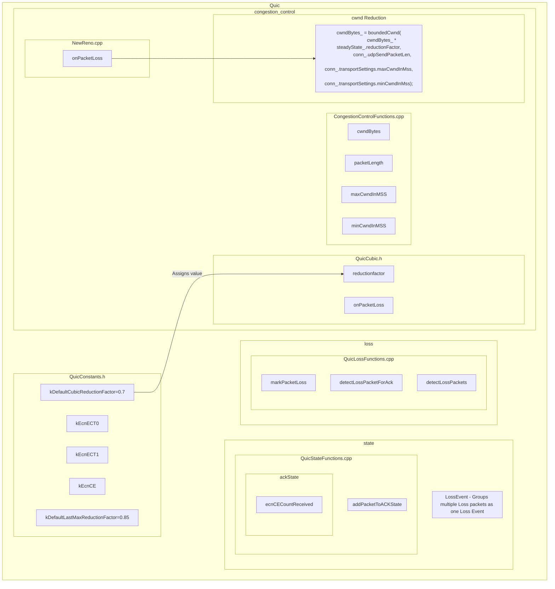

## Quic Loss Events

Quic uses the term LossEvent for wrapping packet losses as a single event like in **LossEvent**

### Use of folly abstractions :
Folly provides abstractions that implement the Linux kernel level IP layer implementation.

So, broadly **folly** takes care of the **Network layer** using **folly::SocketAddress** and **mvfst** builds the **Transport layer** over folly.

**Fizz** provides **TLS1.3** above **Transport Layer** and below **Application Layer**.   


### Diagram of relevant flow concerning Cwnd reduction




## Actual cwnd Reduction Code

- cwndBytes is the parameter reduced on PacketLoss in BBR, NewReno and Cubic CCAs using [boundedCwnd](quic/congestion_control/CongestionControlFunctions.cpp) function in line 15.
```
cwndBytes_ = boundedCwnd(
    cwndBytes_ * steadyState_.reductionFactor,
    conn_.udpSendPacketLen,
    conn_.transportSettings.maxCwndInMss,
    conn_.transportSettings.minCwndInMss);
```
- [QuicAckScheduler.cpp](quic/api/QuicAckScheduler.cpp) line 83 has the code that sets bool value which later triggers ECN reporting.
```
const bool ecnRequiresReporting =
    conn_.transportSettings.readEcnOnIngress &&
    (meta.ackState.ecnECT0CountReceived ||
        meta.ackState.ecnECT1CountReceived ||
        meta.ackState.ecnCECountReceived);
```
- mvfst has different **QUIC ACK Frame Formats (FRAME_TYPE::\<format\>)** with different structure and purpose:

    - ACK - Simple ACK without ECN
    - ACK_ECN - ACK with addition ECN counters (ECT(0), ECT(1), CE)
    - ACK_EXTENDED - ACK with negotiated ACK info
    - ACK_RECEIVE_TIMESTAMPS - ACK with Receive Timestamps
    - ACK_RECEIVE_TIMESTAMPS_DRAFT_02 - IETF Draft-02 receive timestamp format
    - ACK_RECEIVE_TIMESTAMPS_DRAFT_02_ECN - IETF Draft-02 receive timestamp ACK with ECN counts

- **CE counts** are updated in [QuicStateFunction.cpp](quic/state/QuicStateFunctions.cpp) writeNextAcks() function line 470

```
auto ecnValue = udpPacket.tosValue & 0b11;
switch (ecnValue) {
case kEcnCE:
    ackState.ecnCECountReceived++;
    break;
case kEcnECT1:
    ackState.ecnECT1CountReceived++;
    break;
case kEcnECT0:
    ackState.ecnECT0CountReceived++;
    break;
default:
    break;
}
```

- L4S ECN based cwnd reduction occurs in [QuicCubic.cpp](quic/congestion_control/QuicCubic.cpp) line 1010

```
void Cubic::onEcnCongestionEvent(const AckEvent& ack) {
  if (conn_.ecnState == ECNState::ValidatedL4S && conn_.ecnL4sTracker &&
      conn_.ecnL4sTracker->getL4sWeight() >
          conn_.transportSettings.ccaConfig.l4sCETarget) {
    if (ack.largestNewlyAckedPacketSentTime > l4sCwndReducedTimestamp_) {
      invalidateSpuriousLossUndo();
      MVCHECK(conn_.ecnL4sTracker);
      auto distanceToTarget = conn_.ecnL4sTracker->getNormalizedL4sWeight() -
          conn_.transportSettings.ccaConfig.l4sCETarget;
      ssthresh_ = (1.0 - distanceToTarget / 2) * cwndBytes_;

      steadyState_.lastReductionTime = ack.ackTime;
      steadyState_.timeToOrigin = 0.0;
      steadyState_.lastMaxCwndBytes = ssthresh_;
      steadyState_.originPoint = ssthresh_;
      steadyState_.estRenoCwnd = ssthresh_;
      cwndBytes_ = ssthresh_;
      l4sCwndReducedTimestamp_ = ack.ackTime;
    }
  }
  lastCECount_ = ack.ecnCECount;
}

``` 
which is called on by an increase in ecnCECount as in:

```
if (ack.ecnCECount > lastCECount_) {
    onEcnCongestionEvent(ack);
}
```